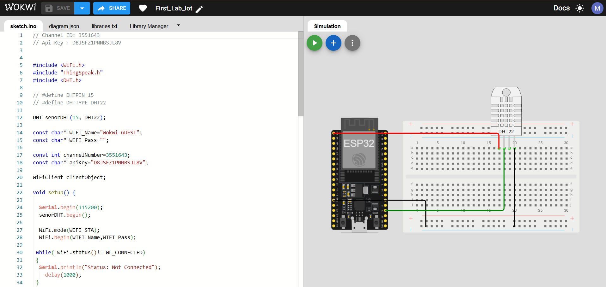
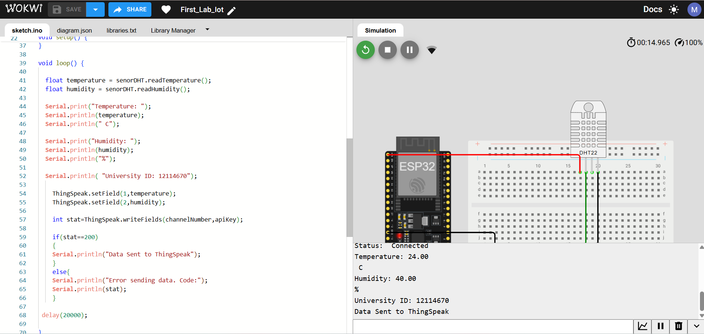
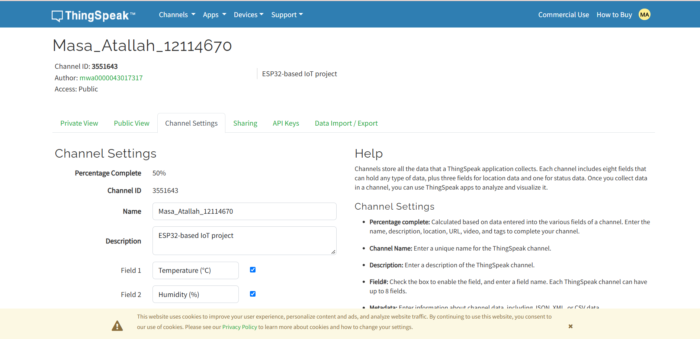
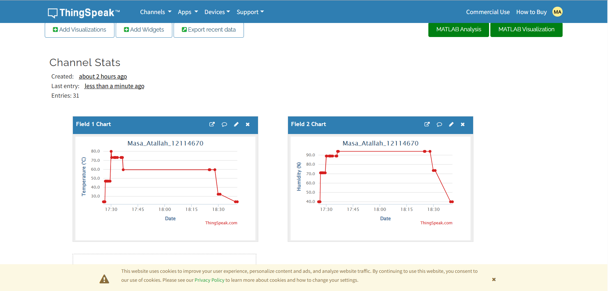
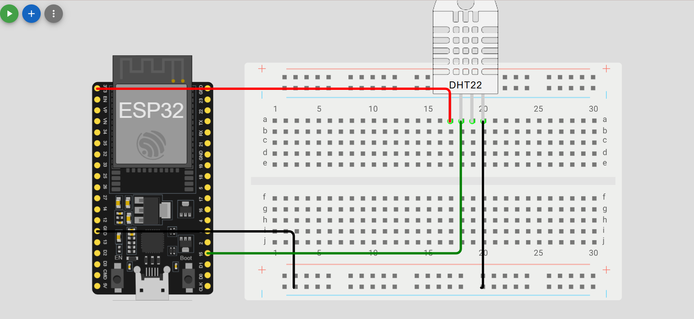

# ESP32 Temperature and Humidity Monitoring using ThingSpeak

- Name: Masa Atallah
- University ID: 12114670

## Project Description
This project uses an ESP32 and a DHT22 sensor to measure temperature
and humidity. The readings are sent to ThingSpeak every 20 seconds
and displayed using live charts.

## Components
- ESP32
- DHT22 sensor
- Wokwi simulator
- ThingSpeak

## Wiring
- DHT22 VCC -> ESP32 3.3V
- DHT22 DATA -> ESP32 GPIO 15
- DHT22 GND -> ESP32 GND

## ThingSpeak Fields
- Field 1: Temperature (°C)
- Field 2: Humidity (%)

## ThingSpeak Public Channel
https://thingspeak.mathworks.com/channels/3551643

## Wokwi Simulation
https://wokwi.com/projects/478961648985076737

## Update Interval
The ESP32 sends temperature and humidity data to ThingSpeak every 20 seconds.

## Screenshots

## Wokwi Circuit

## Serial Monitor

## ThingSpeak Channel

## Temperature & Humidity Graph

## Additional Wokwi Screenshot

